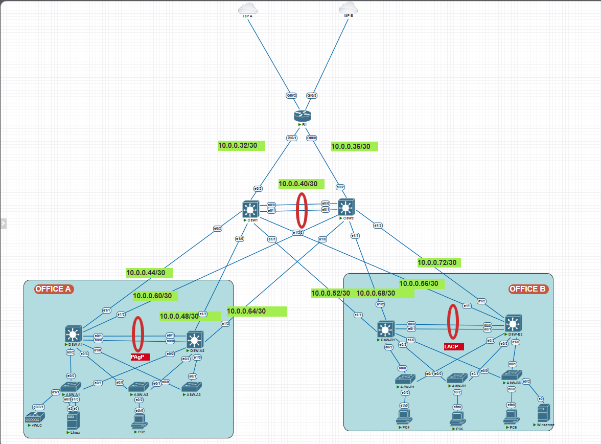

# Lab 01 — CCNA Megalab

**Author:** Sankey Silva | CCNA | JNCIA | ISC2 CC | MSc Cybersecurity  
**Platform:**   
**Reference:** [Jeremy's IT Lab — CCNA Mega Lab](https://www.youtube.com/watch?v=2p7-MluKAgE)  
**Repo:** [multi-vendor-labs](https://github.com/Sankey-nz/multi-vendor-labs)

---

## Topology



The diagram shows the virtual lab topology across Office A and Office B. Both sites connect through a shared routed core (CSW1/CSW2) and edge router (R1). Each office has a distribution pair, access switches, and end hosts. The harvested configs include DHCP pools on R1. Older notes describe a Cisco vWLC in Office A and WIN-SV1 in Office B for domain and network services, but neither device has a committed config or captured show output.

### Reading this lab

1. Read the scenario and follow the diagram from R1 through the routed core to a site's distribution and access layers.
2. Use [`addressing-table.md`](addressing-table.md) for the harvested IPv4/IPv6 addresses, VLAN purposes, and known live exceptions.
3. Follow Parts 1–9 for the concepts and example commands. The examples explain the intended learning task; they are not all a transcript of the current lab.
4. Compare examples with [`configs/`](configs/) before configuring a device. Configuration presence alone does not prove that a feature works end to end.

The lab is a learning environment, not a production deployment. Some exercises describe a design target, while the harvested configs and notes record what is actually present. Each status below distinguishes documented configuration from behavior that remains unverified.

---

## Business Problem and Engineering Request

**Scenario:** SankeyLab is a fictional company operating from two offices. It needs reliable communication between sites, separate networks for users, staff/voice, servers, wireless clients, and network management, and access to shared services and the Internet. The design must include redundancy, controlled access, and a way to verify and troubleshoot failures.

**Engineering request:** Plan the IPv4 subnets and VLANs; build the routed and switched topology; configure redundancy, routing, services, security, IPv6, and wireless; then verify end-to-end connectivity and diagnose injected faults. The nine study parts break this work into manageable stages rather than isolated protocol demonstrations.

This is a virtual lab built with PNetLab and Cisco IOL/IOSv software images—not a physical hardware deployment. The images are not distributed in this repository. Configurations use Cisco IOS-style commands, while the live-state notes call out where the current virtual lab differs from the original design or from a fully validated production network.

---

## Build Requirements and Current Status

The status column describes harvested configuration and verification evidence; it does not claim production readiness. Known live-state limitations are called out below.

| Part | Topic | Engineering task | Recorded status | Guide |
|------|-------|----------|--------|-------|
| 1 | Initial Device Setup | Hostnames, SSH, local authentication, CDP/LLDP | Baseline configuration is documented; see harvested configs for device-specific settings | [P01](../obsidian-notes/P01-Initial-Setup.md) |
| 2 | VLANs & L2 EtherChannel | VLAN membership, 802.1Q trunks, PAgP/LACP | VLANs, trunks, and distribution EtherChannels are present in the harvested configs; VTP use is not assumed | [P02](../obsidian-notes/P02-VLANs-and-L2-EtherChannel.md) |
| 3 | IP Addressing & L3 EtherChannel | Routed links, SVIs, HSRP | IPv4/HSRP configuration is documented; Office A user SVIs on DSW-A2 are administratively down in the recorded config | [P03](../obsidian-notes/P03-IP-Addressing-L3-EtherChannel-HSRP.md) |
| 4 | Spanning Tree | Rapid PVST+, root placement, PortFast, BPDU Guard | Configured settings are documented; verify operational state on the devices | [P04](../obsidian-notes/P04-Rapid-Spanning-Tree.md) |
| 5 | Routing | OSPFv2 Area 0 and default-route advertisement | OSPF and default-information originate are configured; IPv4 default route uses DHCP on R1 Gi0/3, with no IPv4 floating static route in the harvested config | [P05](../obsidian-notes/P05-OSPF-and-Static-Routing.md) |
| 6 | Network Services | DHCP, DNS, NTP, SNMP, Syslog, SSH, PAT | DHCP is configured on R1; its DHCP options point clients to WIN-SV1 for DNS; current NAT is PAT via Gi0/3. Service operation is not verified | [P06](../obsidian-notes/P06-Network-Services.md) |
| 7 | Security | ACLs, port security, DHCP snooping, DAI | ACLs and L2 controls are configured unevenly; P07 records the observed scope and limitations | [P07](../obsidian-notes/P07-Security.md) |
| 8 | IPv6 | IPv6 addressing and static routes | IPv6 is configured on R1 and the core switches only; distribution/access IPv6 and end-to-end IPv6 are not documented as verified | [P08](../obsidian-notes/P08-IPv6.md) |
| 9 | Wireless | vWLC management, WLAN/VLAN concepts, CAPWAP | LAB-STATE reports WLC management on VLAN 99; no WLC config or captured show output is committed, so this remains configured, unverified. AP registration and wireless-client service are unverified | [P09](../obsidian-notes/P09-Wireless-LAN.md) |

---

## Live Topology Notes

Configuration differences visible in the committed harvested snapshots:

**WAN & Routing**
- **Edge Connectivity:** R1 connects directly to ISP-B via Gi0/3 (DHCP).
- **Default Gateway:** Default route is `ip route 0.0.0.0 0.0.0.0 GigabitEthernet0/3 dhcp`.

**Core Architecture**
- **Pure L3 Core:** CSW1 and CSW2 function as a purely routed core.
- **SVI Placement:** No SVIs or HSRP on core switches; all VLAN SVIs and HSRP virtual IPs reside on the DSW distribution layer.

**Device Specifics**
- **WLC1 Management:** Older notes report `10.0.0.7/28` on VLAN 99, replacing the original `192.168.30.20/24` on VLAN 60. No WLC config or captured show output is committed, so this is configured, unverified.
- **DHCP Services:** All pools (A-Mgmt, A-PC, A-Phone, B-Mgmt, B-PC, Wi-Fi) are hosted on R1 rather than WIN-SV1.

## Known Live Exceptions

These are differences or limitations visible in the harvested configurations and current handoff notes. They are recorded here, not corrected in device configs. A config line establishes configured state only; it does not prove operational behavior.

| Area | Known live exception / evidence status |
|------|----------------------------------------|
| DHCP | R1's `A-Mgmt` pool advertises `10.5.0.4` as its default router; the design plan specifies `10.0.0.1`. |
| HSRP | DSW-A2's VLAN 10/20/40 SVIs are administratively down. HSRP is configured, but failover is unverified. |
| Hostname | The ASW-B2 config sets hostname `AWS-B2`. |
| DAI | ASW-B3 trusts DAI on a server-facing port. Confirm the intended trust boundary before changing it. |
| VTY access | VTY ACLs vary by device. Distribution switches and R1 permit `10.1.0.0/24` only. The access switches also permit `10.0.0.0/24` on ASW-A1 and ASW-B1/B2/B3, and `10.0.0.0/28` on ASW-A2/A3. Since VLAN 99 is within `10.0.0.0/28`, the harvested ASW ACLs do not support a blanket claim that VLAN 99 is blocked on all access switches; SSH behavior is not independently verified. |
| Default routes | IPv4 uses DHCP on R1 Gi0/3 and has no floating static route. IPv6 has a floating static route via Gi0/2. |
| IPv6 scope | IPv6 configuration is present only on R1, CSW1, and CSW2 in the committed harvested configs. |
| Wireless | LAB-STATE reports WLC management on VLAN 99 as confirmed, but no WLC config or captured show-command output is committed. Classify management as configured, unverified; AP registration and client service are unverified. |
| Outbound HTTPS/TLS | LAB-STATE reports outbound TLS stalls. A PNetLab/host MTU issue is suspected, not proven; the repository has no captured test transcript. This remains an open issue. |

## How This Lab Was Built

- **Lab design and scenario:** By Sankey Silva. Based on Jeremy's IT Lab CCNA Mega Lab, adapted into the two-office SankeyLab scenario.
- **AI assistance:** GitHub Copilot and Kiro enhanced the design and helped with [config-harvest scripts / documentation audit / topology annotations / other - I will confirm].
- **Verification and fault diagnosis:** Performed by [me / me with agent help - I will confirm].

## SECURITY-NOTES

- These are lab-only devices and services; do not reuse their credentials in production.
- Supply device credentials at run time through environment variables or interactive prompts. Do not commit `.env` files or real credential values.
- Older Git commits may contain previous lab credentials. Those credentials have been changed; repository history has not been rewritten.
- Committed harvested configs have authentication directives and SNMP community values redacted. They remain useful as configuration evidence but are not complete device backups.

---

## Device Inventory

| Device | Hostname | Image | Role |
|--------|----------|-------|------|
| Edge Router | R1 | vios-adventerprisek9-m.SPA.158-3.M2 | OSPF ASBR, PAT, DHCP server, default route |
| Core L3 Switch | CSW1 | L3-IOL-15.4-2T | Pure L3 routed core — OSPF, L3 EtherChannel |
| Core L3 Switch | CSW2 | L3-IOL-15.4-2T | Pure L3 routed core — OSPF, L3 EtherChannel |
| Distribution Switch | DSW-A1 | L2-IOL-high_iron_20180510 | Office A — STP root configured; HSRP/SVI config present (runtime role unverified) |
| Distribution Switch | DSW-A2 | L2-IOL-high_iron_20180510 | Office A — STP secondary configured; VLAN 10/20/40 SVIs administratively down |
| Distribution Switch | DSW-B1 | L2-IOL-high_iron_20180510 | Office B — STP root configured; HSRP/SVI config present (runtime role unverified) |
| Distribution Switch | DSW-B2 | L2-IOL-high_iron_20180510 | Office B — STP secondary configured; HSRP/SVI config present (runtime role unverified) |
| Access Switch | ASW-A1 | L2-IOL-15.2d | Office A — PC1, WLC1 uplink |
| Access Switch | ASW-A2 | L2-IOL-15.2d | Office A — PC2 |
| Access Switch | ASW-A3 | L2-IOL-15.2d | Office A — PC3 |
| Access Switch | ASW-B1 | L2-IOL-15.2d | Office B — PC4 |
| Access Switch | ASW-B2 | L2-IOL-15.2d | Office B — PC5 |
| Access Switch | ASW-B3 | L2-IOL-15.2d | Office B — PC6, WIN-SV1 |
| Wireless LAN Controller | WLC1 | vwlc-8.7.102 | Older notes report WLAN management at 10.0.0.7/28 on VLAN 99; unverified |
| Windows Server | WIN-SV1 | winserver-S2008-R2-x64 | Older notes report AD/DC, DNS, NTP, FTP at 10.5.0.4 on VLAN 30; unverified |
| Management Host | Kali | Kali Linux | Older notes describe management, fault-injection, and packet-capture use |

---

## Skills Demonstrated

**Routing & L3 Services**
- **OSPFv2:** Area 0, passive interfaces, `default-information originate`.
- **L3 Connectivity:** Static routing, PAT/NAT overload, IPv6 dual-stack (EUI-64), static IPv6 routes.

**Switching & L2 Topology**
- **VLANs:** 802.1Q trunking, site-specific VLANs, Rapid PVST+ (STP); VTP is a study concept, not explicitly configured in the harvested configs.
- **Link Aggregation:** EtherChannel (LACP & PAgP), L2 and L3 channels.
- **Redundancy:** HSRP groups are configured across DSW pairs; runtime roles and failover are unverified.

**Security & Network Services**
- **Hardening:** SSHv2, Port Security (sticky MAC), Extended Named ACLs.
- **L2 Security:** DHCP Snooping, Dynamic ARP Inspection (DAI).
- **Infrastructure Services:** DHCP relay (`ip helper-address`), DNS, NTP authentication settings, SNMP v2c, Syslog. End-to-end service operation is not uniformly verified; an FTP-based IOS upgrade is a guide exercise, not a confirmed lab action.

**Wireless & Troubleshooting**
- **Cisco vWLC:** A prior handoff reports VLAN 99 management, but committed config/show-output evidence is absent; treat management as configured, unverified. WLAN/VLAN mapping, CAPWAP registration, and client service are unverified.
- **Diagnostics:** OSI-layer isolation methodology. The eight fault-injection scenarios previously mentioned are not documented in this repository; the count and scenario details are not verified.

---

## Repository Structure

```
multi-vendor-labs/
├── .gitignore
├── README.md
└── labs/
    ├── obsidian-notes/              ← per-part study notes (P01–P09)
    └── lab01-ccna-megalab/
        ├── README.md                ← this file
        ├── addressing-table.md      ← addressing plan and known live exceptions
        ├── LAB-STATE.md             ← config findings and evidence limitations
        ├── .gitignore
        ├── .env.example             ← placeholder environment-variable names
        ├── topology/
        │   ├── topology.png
        │   ├── Screenshot 2026-10-04 220452.png
        │   ├── Screenshot 2026-10-04 230114.png
        │   └── Screenshot 2026-10-04 23011400.png
        ├── configs/                 ← 13 harvested configs; credential lines redacted
        │   ├── R1.txt
        │   ├── CSW1.txt  CSW2.txt
        │   ├── DSW-A1.txt  DSW-A2.txt  DSW-B1.txt  DSW-B2.txt
        │   └── ASW-A1.txt  ASW-A2.txt  ASW-A3.txt
        │       ASW-B1.txt  ASW-B2.txt  ASW-B3.txt
        └── scripts/
            ├── audit/               ← device audit scripts
            ├── harvest/             ← config collection scripts and usage
            ├── troubleshooting/     ← SSH and connectivity test scripts
            ├── requirements.txt
            └── runtime_credentials.py
```

The topology directory contains three additional timestamped screenshots that are not referenced elsewhere in the repository. Their disposition is left for the repository owner; see the review summary before renaming or removing any.

---

## References

- [Jeremy's IT Lab — CCNA Mega Lab](https://www.youtube.com/watch?v=2p7-MluKAgE)
- [PNetLab Documentation](https://pnetlab.com/pages/documentation)
- [Cisco IOS Configuration Guides](https://www.cisco.com/c/en/us/support/index.html)

---

*Built as part of the [multi-vendor-labs](https://github.com/Sankey-nz/multi-vendor-labs) portfolio by Sankey Silva — Auckland, NZ.*
